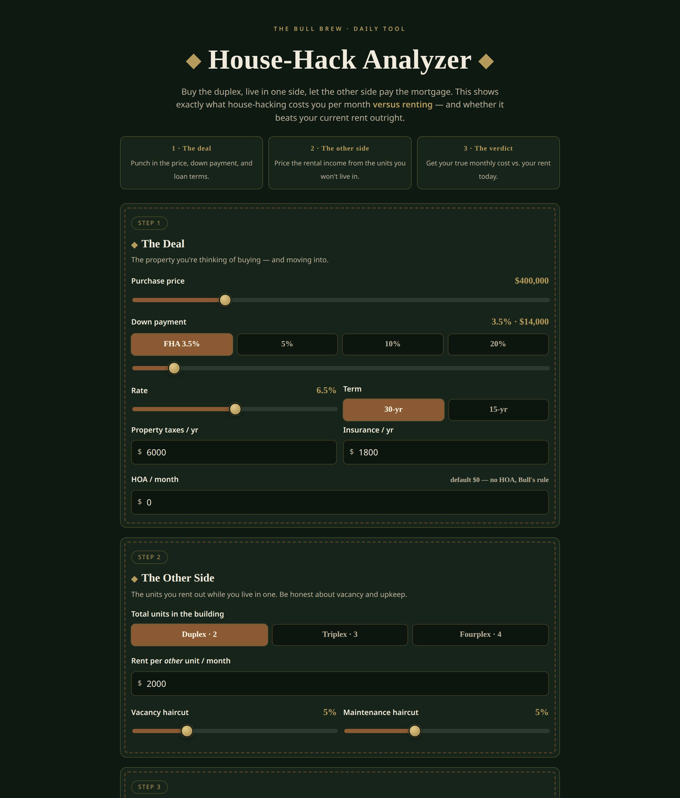

# House-Hack Analyzer

**Live:** https://thebullbrew.github.io/house-hack-analyzer/

Buy the duplex, live in one side, let the other side pay the mortgage. This analyzer shows
exactly what house-hacking costs you per month **versus renting** — and whether it beats
your current rent outright.

## What it does

- **Full PITI math** — principal, interest, taxes, insurance, PMI (auto-applied under 20% down), and HOA.
- **The other side** — 2/3/4-unit toggle, rent per other unit, with vacancy and maintenance haircuts applied before any victory is declared.
- **The verdict** — your true monthly housing cost vs. your rent today: "THIS HACK PAYS YOU," "HACK IT," or "KEEP RENTING."
- **Down-payment showdown** — FHA 3.5% vs. 20% down on the same deal, side by side.
- **Saveable scenarios** — name deals, save them locally, compare duplexes later.

## The method

House-hacking only works if you price it honestly. FHA's 3.5% down payment is the classic
entry — FHA demands owner-occupancy, which is exactly what a house-hack is — but PMI eats
into the margin, so it's in the math. Vacancy and maintenance get haircut off the rental
income *first*; if the deal still beats your rent, the hack is real.

## Run it

No backend, no build step. Open `docs/index.html` in any browser, or install it as a PWA
(manifest + service worker included, works offline). All data stays in your browser's
localStorage — no account, no tracking.

Built with JavaScript. Part of [The Bull Brew](https://github.com/thebullbrew) daily
finance & real-estate tool series.
